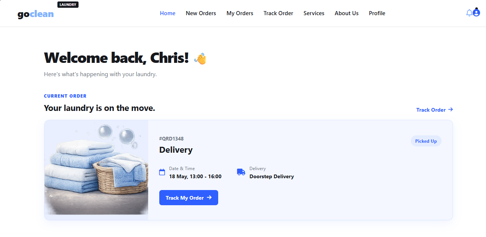
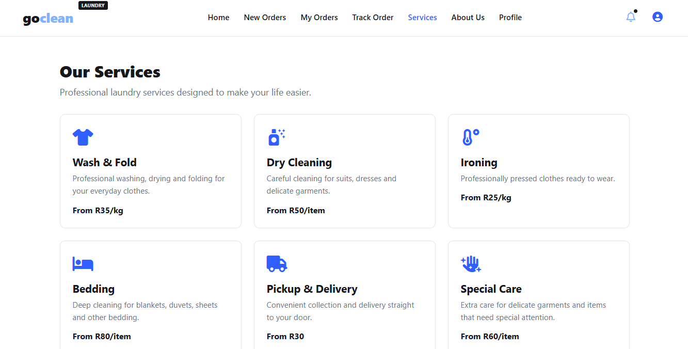
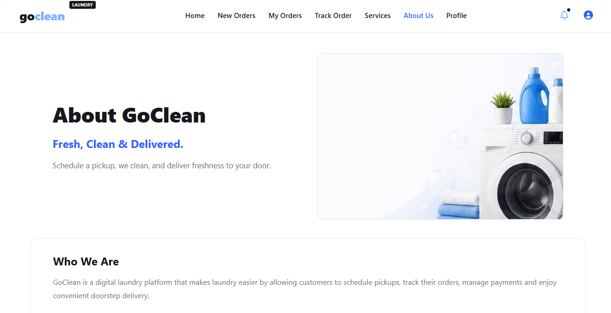
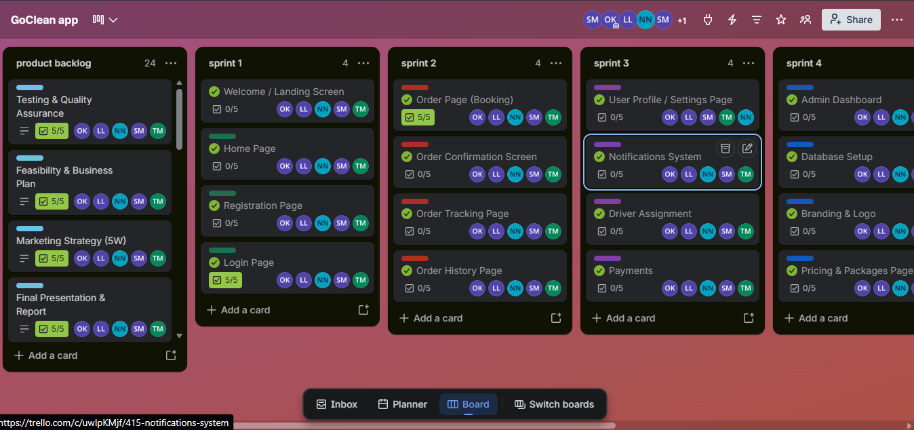
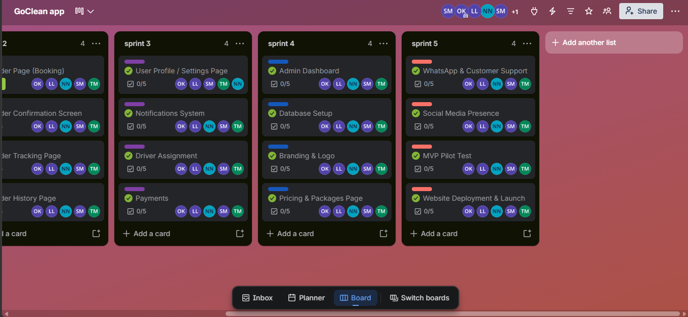

# WIL Project: Agile E-Portfolio

**Project:** Go Clean Laundry Service
**Portfolio Type:** Agile Project E-Portfolio
**Purpose:** Evidence of learning, reflection, and application of Agile practices

---

## Project Overview

### Introduction

Go Clean is a laundry service website developed to make laundry services more accessible and convenient for students, township residents, busy individuals, and other potential customers.

The team planned, designed, and developed the website and presented the completed project. The project provided an opportunity to apply web development skills while exploring how Agile practices support requirements management, task organisation, teamwork, and project delivery.

This e-portfolio documents evidence from the Go Clean project and evaluates the learning gained through five Agile artefacts: the Agile Team Charter, User Stories and Tasks, Product Backlog, Sprint Backlog, and Agile Logbook.

Rather than presenting only the final website, this portfolio connects the project outcome to the planning, organisation, and reflective practices associated with Agile development.

### Project Objectives

The objectives of Go Clean were to:

* Develop a user-friendly website for a laundry service.
* Present laundry service information in an accessible format.
* Provide a convenient digital platform for potential customers.
* Organise project requirements and development activities.
* Support collaboration through structured project planning.
* Apply Agile concepts and reflect on their value during development.

### Project Management Tool

The team used Trello to organise project activities and maintain project information.

**Project board:** [Access the Go Clean Trello Board](https://trello.com/b/Ia2c4Am0)

The board provides evidence of the team's task organisation and contains the User Stories and tasks, as well as Product Backlog information. It complements the other artefacts by showing how project work was documented and organised.

---

## The E-Portfolio Process

This e-portfolio follows four stages: **Collect, Select, Reflect, and Connect**. Together, these stages support the identification of relevant evidence, evaluation of learning, and connection between practical experience and Agile principles.

### Collect

The Collect stage involves gathering evidence that demonstrates the work completed during the Go Clean project.

The evidence presented includes screenshots of the Home, Services, and About Us pages, together with the five required Agile artefacts. These items provide a record of the product developed and the practices used to organise the project.

### Select

The Select stage involves choosing evidence that is relevant to the portfolio's learning objectives and assessment criteria.

The three website screenshots were selected to demonstrate different aspects of the product. The Agile artefacts were selected because they represent different elements of the development process, including team collaboration, requirements definition, backlog management, sprint planning, and progress documentation.

The selection aims to provide a balanced view of both the final product and the practices supporting its development.

### Reflect

The Reflect stage involves critically examining the experience gained from the project.

The reflections throughout this portfolio consider the purpose of each artefact, the learning it supports, and its relevance to collaborative software development. They also provide an opportunity to identify how this knowledge can be applied to future projects.

### Connect

The Connect stage involves relating the evidence and reflections to Agile principles and practices.

The artefacts are connected because they contribute to different aspects of project delivery. The team charter establishes shared expectations, user stories describe requirements from the user's perspective, the Product Backlog organises the work required, the Sprint Backlog focuses on selected work, and the Agile Logbook records progress and learning.

Together, these elements demonstrate how structured planning and reflection can support the development process.

---

## Go Clean Website Evidence

The following screenshots provide visual evidence of the website developed by the team. They supplement the Agile artefacts by demonstrating the resulting product.

### Home Page

**Evidence description:** The Home page introduces the Go Clean platform and provides an overview of the laundry service.

**Relevance:** This screenshot demonstrates the website's entry point and how the platform is presented to potential customers.

### Services Page

**Evidence description:** The Services page presents information about the laundry services available through the platform.

**Relevance:** This screenshot demonstrates how service information is communicated to users.

### About Us Page

**Evidence description:** The About Us page communicates information about Go Clean and its purpose.

**Relevance:** This screenshot provides additional context about the service and its intended audience.

### Reflection on Website Evidence

The screenshots demonstrate selected parts of the website developed by the team and provide a visual record of the project outcome. Selecting pages with different purposes gives the reviewer a broader understanding of the product than a single screenshot would provide.

The screenshots also complement the written artefacts. While the website evidence demonstrates the resulting product, the Agile artefacts provide insight into how requirements, tasks, responsibilities, and progress were organised.

### Connection to Agile Practice

Agile development emphasises delivering useful product functionality and learning from the development process. The screenshots provide evidence of the product outcome, while the supporting artefacts help explain the planning and organisation behind that outcome.

The screenshots should therefore be considered alongside the five assessed artefacts rather than as a replacement for them.

---

## Agile Team Charter

### Purpose

The Agile Team Charter establishes a shared understanding of the team's objectives, responsibilities, working agreements, and communication expectations. It provides a foundation for collaboration and helps team members understand their collective responsibilities.

### Evidence

**Agile Team Charter:** []

### Reflection

The team charter helped me understand the importance of establishing shared expectations when working on a group project. Technical contributions need to be supported by communication, accountability, and an understanding of the team's objectives.

I learned that unclear expectations can make collaboration more difficult, particularly when several team members are responsible for different parts of the same product. Establishing agreed responsibilities can help team members coordinate their contributions and work towards a common outcome.

This experience strengthened my understanding that teamwork is an essential part of software development, rather than a separate activity from the technical work.

### Connection to Agile Practice

The team charter supports the collaborative nature of Agile development. Shared expectations and responsibilities help create a foundation for communication, coordination, and collective ownership of project outcomes.

It also connects to the other artefacts because requirements and tasks can only be delivered effectively when team members understand how they are expected to contribute.

---

## User Stories and Tasks

### Purpose

User stories express requirements from the perspective of the intended user. Tasks break the work associated with those requirements into manageable activities that can be organised and completed by the team.

Together, they help translate user needs into actionable development work.

### Evidence

**User Stories and Tasks:** [Access the Go Clean Trello Board](https://trello.com/b/Ia2c4Am0)

Refer to the relevant cards or lists containing the project's user stories and associated tasks.

### Reflection

Working with user stories and tasks helped me understand the relationship between user needs and the work required to develop a product. A system should not be developed solely around technical possibilities; its functionality should also address the needs of its intended users.

I also learned that breaking requirements into smaller tasks makes the work easier to understand and organise. This supports clearer communication about what needs to be completed and helps the team manage its activities.

The experience reinforced the importance of connecting the purpose of a feature with the practical work required to implement it.

### Connection to Agile Practice

User stories support user-focused requirements definition, while tasks help translate requirements into actionable work.

For Go Clean, this relationship connects the needs of potential laundry service customers with the website functionality the team intended to provide. The stories and tasks also contribute to the wider Product Backlog by describing and organising the work required for the product.

---

## Product Backlog

### Purpose

The Product Backlog is an organised list of product requirements, features, improvements, and other work that may be needed. It provides visibility of the work associated with the product and supports prioritisation as the project evolves.

### Evidence

**Product Backlog:** [Access the Go Clean Trello Board](https://trello.com/b/Ia2c4Am0)

Refer to the relevant backlog items on the board.

### Reflection

Working with the Product Backlog helped me understand the importance of maintaining an organised view of the work required for a project. Without a clear overview of requirements and tasks, it can be more difficult to understand the scope of the product and determine which activities need attention.

I learned that backlog management supports planning by making project work more visible and easier to organise. It also helps connect individual tasks to the broader purpose of the product.

This experience improved my understanding of how requirements management contributes to an organised development process.

### Connection to Agile Practice

The Product Backlog supports iterative development by maintaining a view of the work required for the product. It provides a basis for discussing priorities and selecting appropriate work as development progresses.

It connects to user stories because those stories can represent product requirements, and it connects to the Sprint Backlog because selected backlog items can inform the work planned for a sprint.

---

## Sprint Backlog

### Purpose

The Sprint Backlog identifies the work selected for a particular sprint and the plan for delivering it. It helps the team focus on a defined set of activities during a development period.

Unlike the Product Backlog, which represents the broader work associated with the product, the Sprint Backlog focuses on the work selected for a specific sprint.

### Evidence

**Sprint Backlog:** [Access the Go Clean Trello Board](https://trello.com/b/Ia2c4Am0)

The evidence should make it clear which tasks were selected for the sprint and how they relate to the team's development objectives.

### Reflection

Working with sprint-related planning helped me understand the importance of organising development work into manageable activities. A defined set of tasks gives the team a clearer focus and helps members understand how their work contributes to the intended outcome.

I learned that sprint planning is not simply a list of tasks; it connects selected work to a short-term development objective. This distinction helps separate the broader requirements of a product from the work the team intends to address during a particular sprint.

### Connection to Agile Practice

The Sprint Backlog supports focused planning and incremental delivery. It connects the broader Product Backlog with the work selected for a particular development period.

Together, these artefacts help show how a team can organise the overall scope of a product while maintaining focus on specific development activities.

---

## Agile Logbook

### Purpose

The Agile Logbook documents project activities, progress, challenges, decisions, and learning throughout the development process. It provides a record of the work undertaken and supports reflection on the experience.

### Evidence

**Agile Logbook:** [https://docs.google.com/document/d/1OyutJqosLBLszfGnYPrG4DgOu2Qcae8U/edit?usp=sharing&ouid=104881683205263797303&rtpof=true&sd=true]

### Reflection

The Agile Logbook helped me recognise the value of documenting project activities and reviewing progress. Project documentation can provide a record of what was done and create an opportunity to consider the decisions and experiences that influenced the work.

I learned that reflection is more useful when it goes beyond listing completed activities. Considering what was learned, what could be improved, and how that learning can be applied in the future helps turn project experience into professional development.

The logbook therefore connects the practical work completed during the project with the learning documented in this portfolio.

### Connection to Agile Practice

The Agile Logbook supports transparency, reflection, and continuous improvement. It complements the other artefacts by providing a record of project activities and learning.

Its value lies not only in documenting progress, but also in helping individuals consider how their experiences can inform their approach to future projects.

---

## Integrated Reflection

The Go Clean project strengthened my understanding of how Agile practices contribute to software development. Examining the five artefacts helped me recognise that each serves a different purpose while contributing to the overall organisation of the project.

The Agile Team Charter establishes shared expectations, while User Stories and Tasks connect user needs to actionable work. The Product Backlog provides an overview of the work required for the product, and the Sprint Backlog focuses on work selected for a particular development period. The Agile Logbook records progress and supports reflection on the development experience.

A key lesson from the project is that successful software development involves more than producing a functional website. Requirements need to be understood, activities need to be organised, team members need to collaborate, and progress needs to be reviewed.

The e-portfolio process also encouraged me to consider how evidence can demonstrate learning. Collecting and selecting relevant material helped organise the project record, while reflection and connection helped explain why the evidence matters and how it relates to Agile practices.

Going forward, I would apply these lessons by ensuring that requirements are clearly understood, project tasks are organised, responsibilities are communicated, and learning is documented throughout development. These practices can support more effective collaboration and better-informed decisions in future projects.

---

## Conclusion

This e-portfolio documents the Go Clean website, presents evidence of the project's Agile artefacts, and reflects on the learning gained through the development process.

The portfolio connects the practical outcome of the project with the planning, requirements management, task organisation, and reflection that support collaborative software development.

Completing this portfolio has helped me develop a clearer understanding of Agile practices and their relevance to project delivery. The experience provides a foundation for applying these principles to future academic and professional projects.

WIL Project Reflection attached.
https://mycputac-my.sharepoint.com/:w:/g/personal/222359366_mycput_ac_za/IQArhO136pEZT5Oa7M2tl1f3AZx1i76SjQdFW5E1TUoJKPs?e=adMpQk
